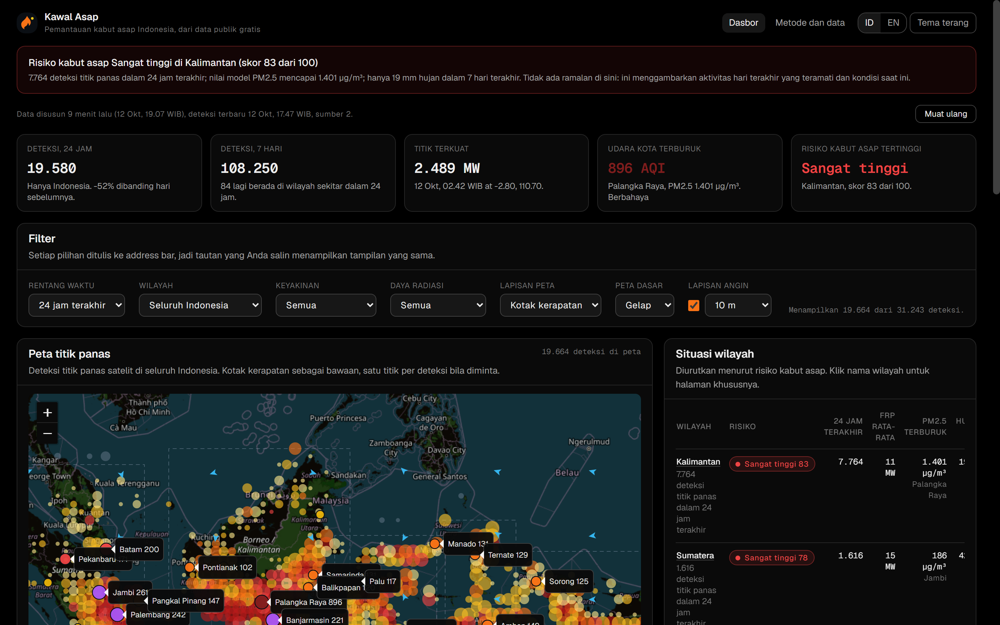

# Kawal Asap

Hotspot and haze monitoring for Indonesia, built entirely from free and keyless public
data. No account, no API key, no paid tier, and that is a hard rule rather than a
preference: if a source starts asking for a key, the source goes.

Pantauan titik panas dan kabut asap Indonesia. Datanya dari sumber publik gratis: tanpa
kunci API, tanpa akun, tanpa langganan.



## What it shows

- **Hotspots on a map**, from NASA FIRMS satellite detections. Cells merge as you zoom
  out, so an archipelago view stays countable instead of becoming a grey smear.
- **Air quality for 35 Indonesian cities**, plus any place you pick: search a city or
  click the map and the panel reads the model at that point.
- **A city summary** when you pick a place: PM2.5, the index, PM10, the detections in
  that city's province, where the value sits on the index scale, an eight day trend, and
  three concrete lines for that band. The panel is master-detail, so the list and the
  summary are never fighting for the same column.
- **A regional risk table** for the seven Indonesian regions, from a weighted heuristic
  that is labelled as ours wherever it appears.
- **Wind and dryness context**, because a hotspot on its own does not say whether it will
  spread.
- **Indonesian first, English second.** The language lives in `?lang=`, so an English view
  is a link you can send someone.

## Where the data comes from

| Source | What we read from it | Cadence | Cost |
| --- | --- | --- | --- |
| [NASA FIRMS](https://firms.modaps.eosdis.nasa.gov/active_fire/) | VIIRS and MODIS thermal anomalies (CSV) | near real time, hours after the satellite pass | free, keyless |
| [Open-Meteo air quality](https://open-meteo.com/en/docs/air-quality-api) | `pm2_5`, `pm10` for 35 cities plus a pinned point, batched into one request | hourly model | free, keyless |
| [Open-Meteo forecast](https://open-meteo.com/en/docs) | wind at 10 m and 850 hPa, seven day precipitation | hourly and daily | free, keyless |
| [Open-Meteo geocoding](https://open-meteo.com/en/docs/geocoding-api) | place names and coordinates, restricted to Indonesia | on demand | free, keyless |
| [OpenStreetMap tiles](https://www.openstreetmap.org/copyright) | the basemap, in both themes | continuous | free, attribution required |

Nothing else is fetched, and nothing is sent anywhere. There is no analytics, no account,
and no cookie. What you keep in your browser is a theme preference and a 24 hour cache.

## What it says, and what it will not say

The wording is part of the product, not decoration. If this tool ever reads as an official
warning service, it has failed.

- **A detection is a detection.** We show thermal anomalies from a satellite; we do not
  confirm fires. The Indonesian wording is *deteksi* or *titik panas*, never *kebakaran*.
- **A model value is a model value, and we name the model.** PM2.5 here comes from the
  CAMS global model, so it shows the regional picture well and can miss a street level
  difference.
- **The air index is derived from PM2.5**, using the US EPA 24 hour breakpoints, rather
  than read from the provider's own index: Open-Meteo has answered `us_aqi 550` beside
  `pm2_5 33.3 µg/m³`, and a badge that contradicts the number next to it is a bug.
- **The regional risk score is our heuristic**, not an official forecast or a warning. The
  method page spells out all five weights.
- **Guidance for residents is general guidance for the index band**, in visible text, and
  it says what it is not: not medical advice and not an official warning.
- **Every panel carries its own timestamp.** Stale data with a visible time is honest;
  stale data presented as live is not.
- **Missing data renders as `tidak tersedia` / n/a.** Never a zero, never a guess, never
  yesterday's value.
- **Nothing we cannot support.** There is no "12% down on last week" and no "confirmed
  fire", because this data cannot produce either claim.

## Running it locally

```bash
npm install
npm run dev        # http://localhost:5173
npm run lint
npm run build
npm run api:cli    # fetch the real data and print counts and sizes
```

`npm run dev` is enough for everything except the hotspot layer, because the FIRMS CSV
endpoint sends no CORS header. That is the only reason a server exists in this project:

```bash
netlify dev        # serves netlify/functions/fires.ts and proxies /api/fires
```

Nothing is done until `tsc`, `npm run lint` and `npm run build` are all clean.

## Caching is a feature, not an optimisation

Four layers, all deliberate, so the project stays inside free limits:

| Layer | Where | Window |
| --- | --- | --- |
| Query cache | TanStack Query `staleTime` | 15 minutes |
| Persisted cache | `localStorage` (a reload is served from it) | 24 hours |
| In-function memo | `netlify/functions/fires.ts` | 10 minutes (2 when the payload is partial) |
| CDN | `netlify.toml` `s-maxage` | 15 minutes |

Raising a request count "for freshness" is a regression. Show the timestamp instead.

## Project structure

| Path | Owns |
| --- | --- |
| `src/lib/*` | data shaping, formatting, risk scoring, i18n, view state |
| `src/hooks/*` | one query per external source, plus `useCountUp` |
| `src/components/*` | presentational, no fetching except through the hooks |
| `src/components/ui/*` | `Card`, `Badge`, `InfoTip` and the small primitives |
| `src/routes/*` | layout and three pages, no data logic |
| `src/locales/*.json` | every user visible string, keyed flat |
| `shared/regions.ts` | provinces, bounding boxes, neighbours. Shared with the function |
| `netlify/functions/fires.ts` | the only server code |
| `docs/design.md` | the design system and the reasoning behind it |
| `docs/mockup/redesign.html` | the settled layout, kept in sync with the app |
| `AGENTS.md` | the rules for working in this repo |

## Status, honestly

- **Not deployed yet.** It runs locally.
- **The hotspot layer needs the function, and the function does not fit Netlify's
  synchronous limit.** NASA serves the FIRMS CSV at roughly 0.2 MB/s, so the 7 day South
  East Asia file takes 54 to 59 seconds to download, against a 10 second limit. Fine for
  local development; wrong for a deploy. The fix is decided and not built: a scheduled
  background function that writes the CSV into Netlify Blobs, with `fires.ts` reading the
  blob instead of NASA.
- **CARTO basemaps now need an API key**, so both themes use OpenStreetMap tiles and the
  dark look is a CSS filter on the tile layer only. Detections keep their real colours.
- **NASA's FIRMS WMS looks usable and is not**: it advertises CORS and then returns the
  same 27 KB placeholder tile for every request.
- **GIBS publishes the thermal anomaly layers as Mapbox vector tiles** (`.mvt`, Level 8).
  Unexplored, and the most promising path to dropping the server function entirely.
- **35 curated cities** ship with the app. Anywhere else comes from the geocoder or from a
  click on the map, which is why the place search is restricted to Indonesia.

## Stack

- **React 19 + Vite 7**, TypeScript strict, no server rendering. A dashboard gains nothing
  from SSR and pays a runtime for it.
- **TanStack Router** with real routes (`/`, `/region/$regionId`, `/method`). No hash
  routing, and all view state lives in the query string, including the language and a
  pinned place, so every view is linkable and refreshable.
- **TanStack Query** with a `localStorage` persister, one query per source.
- **Leaflet** with a canvas renderer and zoom-aware binning for the detection layer.
- **Tailwind 3.4** with Geist tokens. Solid 1px borders, no blur, no glow, one accent,
  mono with tabular figures for every number.
- **One Netlify function**, because of a missing CORS header and nothing else.
- Bundle: 601 kB of JavaScript (187 kB gzipped) and 36 kB of CSS (11 kB gzipped).

## Design

`docs/design.md` is the source of truth, and `docs/mockup/redesign.html` is the settled
layout that both the app and the doc are held to. The short version: Geist tokens from
`src/index.css`, one accent, severity always as a solid badge with auto-contrast ink and an
icon, definitions behind an info button while caveats stay in visible text, and motion that
is small, short, and switched off entirely for `prefers-reduced-motion`.

## Licence

MIT. See [LICENSE](LICENSE).

## Credit

The visual language follows [Vercel's Geist design system](https://vercel.com/design).
Basemap tiles are © [OpenStreetMap](https://www.openstreetmap.org/copyright) contributors.
Hotspot data is from [NASA FIRMS](https://firms.modaps.eosdis.nasa.gov/active_fire/);
weather, air quality and place names are from [Open-Meteo](https://open-meteo.com/).
